# Database

PostgreSQL 16, typed queries with Kysely. Table types live in `backend/src/db/types.ts`.

## Migrations

In-code migrations in `backend/src/db/migrations/`, registered in `backend/src/db/index.ts` and applied at startup by the Kysely `Migrator`:

| Migration | Content |
|---|---|
| `001_full_schema` | Initial schema (all base tables, indexes, `search_vector` trigger) |
| `002_webhook_auth` | `webhooks.auth_user`, `webhooks.auth_password` |
| `003_archive_trash` | `archived_mails.deleted_at` (trash), `system_config` table + default values |
| `004_gmail_labels` | `gmail_labels` table (per-account mirror of Gmail labels) |
| `005_newsletter_scans` | `newsletter_scans` table (result of the `scan_unsubscribe` job) |
| `006_rule_templates` | `rules.template_id` + unique index `(account_id, template_id)` |
| `007_archive_body_text` | `archived_mails.body_text`, added to `search_vector` (weight D) |
| `008_account_backup_prefs` | `mail_accounts.backup_enabled`, `backup_interval`, `last_backup_at`, `auth_error_at` ; nullable tokens ; `notification_preferences.remote_images` |
| `009_drop_pii_tracking` | Drops the `pii_findings` and `tracking_pixels` tables |
| `010_password_changed_at` | `users.password_changed_at`: JWTs issued before it are rejected (password change / reset) |
| `011_passkeys` | `passkeys` table (WebAuthn): unique `credential_id`, public key, counter, transports, name; removed with the user |

---

## ERD Schema

```mermaid
erDiagram
    users {
        uuid id PK
        varchar email "unique"
        varchar password_hash "nullable (SSO)"
        varchar role "user | admin"
        varchar display_name
        text avatar_url
        varchar google_id "nullable, unique"
        boolean is_active "default true"
        integer max_gmail_accounts "default 3"
        bigint storage_quota_bytes "default 5 GB"
        varchar totp_secret "nullable"
        boolean totp_enabled "default false"
        varchar encryption_key_hash "nullable"
        timestamptz last_login_at
        timestamptz password_changed_at
        timestamptz created_at
        timestamptz updated_at
    }

    user_social_accounts {
        uuid id PK
        uuid user_id FK
        varchar provider "google | microsoft | discord | ..."
        varchar provider_id
        varchar email
        varchar display_name
        text avatar_url
        timestamptz created_at
    }

    mail_accounts {
        uuid id PK
        uuid user_id FK
        varchar email
        text access_token "nullable (disconnected)"
        text refresh_token "nullable (disconnected)"
        timestamptz token_expiry
        boolean is_active "false = disconnected"
        boolean backup_enabled "default false"
        text backup_interval "1h | 6h | 24h, default 24h"
        timestamptz last_backup_at
        timestamptz auth_error_at "reconnection required"
        timestamptz created_at
        timestamptz updated_at
    }

    archived_mails {
        uuid id PK
        uuid account_id FK
        varchar gmail_message_id
        varchar thread_id
        text in_reply_to
        text references_header
        text subject
        varchar sender
        text recipient
        timestamptz date
        bigint size_bytes
        boolean has_attachments
        text[] label_ids
        text eml_path
        text snippet
        text attachment_names
        text body_text "NULL when encrypted"
        boolean is_encrypted "default false"
        tsvector search_vector "trigger"
        timestamptz archived_at
        timestamptz deleted_at "nullable, trash"
    }

    archived_attachments {
        uuid id PK
        uuid archived_mail_id FK
        varchar filename
        varchar mime_type
        bigint size_bytes
        text file_path
        varchar content_hash "deduplication"
        timestamptz created_at
    }

    archive_shares {
        uuid id PK
        uuid archived_mail_id FK
        uuid user_id FK
        varchar token "unique"
        timestamptz expires_at
        integer access_count
        integer max_access "nullable"
        timestamptz created_at
    }

    rules {
        uuid id PK
        uuid account_id FK
        varchar name
        text description
        jsonb conditions
        jsonb action
        varchar schedule "hourly | daily | weekly | monthly"
        boolean is_active
        timestamptz last_run_at
        text template_id "nullable"
        timestamptz created_at
        timestamptz updated_at
    }

    jobs {
        uuid id PK
        varchar bullmq_id
        varchar type
        varchar status "scheduled | pending | active | completed | failed | cancelled"
        integer progress
        integer total
        integer processed
        uuid account_id FK "nullable"
        uuid user_id FK "nullable"
        jsonb payload "without credentials"
        text error
        timestamptz created_at
        timestamptz completed_at
    }

    gmail_labels {
        uuid account_id PK,FK
        varchar id PK "Gmail id or imported:<name>"
        text name
        varchar color_bg "nullable"
        varchar color_text "nullable"
        varchar type "system | user | category | imported"
        integer messages_total "nullable"
        timestamptz deleted_at "nullable, soft-delete"
        timestamptz updated_at
    }

    newsletter_scans {
        uuid account_id PK,FK
        jsonb senders
        timestamptz scanned_at
    }

    email_expirations {
        uuid id PK
        uuid account_id FK
        varchar gmail_message_id
        text subject
        text sender
        timestamptz expires_at
        varchar category "manual | otp | delivery | promo"
        boolean is_deleted
        timestamptz deleted_at
        timestamptz created_at
    }

    saved_searches {
        uuid id PK
        uuid user_id FK
        varchar name
        text query
        varchar icon
        varchar color
        integer sort_order
        timestamptz created_at
        timestamptz updated_at
    }

    retention_policies {
        uuid id PK
        uuid user_id FK
        uuid account_id FK "nullable"
        varchar name
        varchar label "nullable"
        integer max_age_days
        boolean is_active "default true"
        timestamptz last_run_at "nullable"
        integer deleted_count "default 0"
        timestamptz created_at
        timestamptz updated_at
    }

    notifications {
        uuid id PK
        uuid user_id FK
        varchar type
        varchar title
        text body
        jsonb data
        boolean is_read "default false"
        timestamptz created_at
    }

    notification_preferences {
        uuid id PK
        uuid user_id FK "unique"
        boolean weekly_report "default true"
        boolean job_completed "default true"
        boolean job_failed "default true"
        boolean rule_executed "default false"
        boolean quota_warning "default true"
        boolean integrity_alert "default true"
        boolean account_reauth "default true"
        boolean weekly_report_toast "default false"
        boolean job_completed_toast "default true"
        boolean job_failed_toast "default true"
        boolean rule_executed_toast "default false"
        boolean quota_warning_toast "default false"
        boolean integrity_alert_toast "default false"
        boolean account_reauth_toast "default false"
        text remote_images "block | allow, default block"
        timestamptz updated_at
    }

    webhooks {
        uuid id PK
        uuid user_id FK
        varchar name "max 100"
        text url
        varchar type "generic | discord | slack | ntfy"
        text[] events
        boolean is_active "default true"
        varchar secret "nullable, HMAC generic"
        varchar auth_user "nullable"
        varchar auth_password "nullable"
        timestamptz last_triggered_at
        integer last_status
        timestamptz created_at
    }

    audit_logs {
        uuid id PK
        uuid user_id FK
        varchar action "ex: user.login, rule.create"
        varchar target_type "nullable"
        varchar target_id "nullable"
        jsonb details "nullable"
        varchar ip_address "nullable"
        timestamptz created_at
    }

    sender_scores {
        uuid id PK
        uuid account_id FK
        varchar sender
        integer email_count
        bigint total_size_bytes
        integer unread_count
        boolean has_unsubscribe
        real read_rate
        real clutter_score "0-100"
        timestamptz computed_at
    }

    cleanup_suggestions {
        uuid id PK
        uuid account_id FK
        varchar type
        varchar title
        text description
        varchar sender
        integer email_count
        bigint total_size_bytes
        text query
        boolean is_dismissed
        timestamptz computed_at
    }

    inbox_zero_snapshots {
        uuid id PK
        uuid account_id FK
        integer inbox_count
        integer unread_count
        timestamptz recorded_at
    }

    gmail_api_usage {
        uuid id PK
        uuid account_id FK
        varchar endpoint
        integer quota_units "default 5"
        timestamptz recorded_at
    }

    system_config {
        varchar key PK "max 100"
        jsonb value
        timestamptz updated_at
    }

    users ||--o{ user_social_accounts : "signs in with"
    users ||--o{ mail_accounts : "owns"
    mail_accounts ||--o{ archived_mails : "archives"
    archived_mails ||--o{ archived_attachments : "contains"
    archived_mails ||--o{ archive_shares : "shared through"
    users ||--o{ archive_shares : "creates"
    mail_accounts ||--o{ gmail_labels : "synced labels"
    mail_accounts ||--o| newsletter_scans : "latest scan"
    mail_accounts ||--o{ email_expirations : "expires"
    mail_accounts ||--o{ rules : "defines"
    mail_accounts ||--o{ jobs : "generates"
    users ||--o{ jobs : "owns"
    users ||--o{ saved_searches : "saves"
    users ||--o{ retention_policies : "configures"
    users ||--o{ notifications : "receives"
    users ||--o| notification_preferences : "settings"
    users ||--o{ webhooks : "configures"
    users ||--o{ audit_logs : "logs"
    mail_accounts ||--o{ sender_scores : "analyzes"
    mail_accounts ||--o{ cleanup_suggestions : "analyzes"
    mail_accounts ||--o{ inbox_zero_snapshots : "tracks"
    mail_accounts ||--o{ gmail_api_usage : "tracks"
```



::: info `storage_configs` table
Migration 001 also creates `storage_configs` (one `local | s3` storage configuration per user). It is neither typed in `types.ts` nor read by the current code.
:::

---

## Index

| Table | Index | Type | Purpose |
|---|---|---|---|
| `users` | `email` | Unique | Login |
| `users` | `google_id` (partiel, non NULL) | Unique | Google SSO lookup |
| `user_social_accounts` | `(provider, provider_id)` | Unique | SSO lookup |
| `user_social_accounts` | `user_id` | BTree | A user's linked accounts |
| `archived_mails` | `search_vector` | GIN | Full-text search |
| `archived_mails` | `account_id` | BTree | Filter by account |
| `archived_mails` | `sender` | BTree | Filter by sender |
| `archived_mails` | `date DESC` | BTree | Sort by date |
| `archived_mails` | `size_bytes DESC` | BTree | Sort by size |
| `archived_mails` | `(account_id, thread_id)` (partial) | BTree | Threads |
| `archived_mails` | `(account_id, deleted_at)` (partial, `deleted_at IS NOT NULL`) | BTree | Trash listing |
| `archived_attachments` | `archived_mail_id` | BTree | Mails ↔ attachments join |
| `archived_attachments` | `content_hash` | BTree | Deduplication |
| `archive_shares` | `token` | Unique | Share link access |
| `archive_shares` | `archived_mail_id`, `expires_at` | BTree | A mail's shares, cleanup |
| `rules` | `(account_id, template_id)` (partial) | Unique | Idempotent creation from a template |
| `jobs` | `account_id` | BTree | Filter jobs by account |
| `jobs` | `status` | BTree | Filter by status |
| `jobs` | `created_at DESC` | BTree | Sort by date |
| `jobs` | `user_id` | BTree | Filter jobs by user |
| `gmail_labels` | `(account_id, id)` | PK | An account's labels |
| `newsletter_scans` | `account_id` | PK | One scan per account |
| `email_expirations` | `account_id`, `expires_at` | BTree | Expiration processing |
| `email_expirations` | `(account_id, gmail_message_id)` (partial, `is_deleted = false`) | Unique | One active expiration per mail |
| `saved_searches` | `user_id` | BTree | Filter by user |
| `retention_policies` | `user_id` | BTree | Filter by user |
| `notifications` | `(user_id, created_at)` | BTree | Notifications per user |
| `notification_preferences` | `user_id` | Unique | One row per user |
| `audit_logs` | `(user_id, created_at)` | BTree | Logs per user |
| `audit_logs` | `(action, created_at)` | BTree | Filter by action |
| `webhooks` | `user_id` | BTree | Filter by user |
| `sender_scores` | `(account_id, sender)` | Unique | One score per sender |
| `inbox_zero_snapshots` | `(account_id, recorded_at DESC)` | BTree | History |
| `gmail_api_usage` | `(account_id, recorded_at)` | BTree | Quota stats per account |
| `gmail_api_usage` | `recorded_at` | BTree | Old data cleanup |

---

## Full-Text Search

The `search_vector` field is updated by the `mail_search_vector_update` trigger (function `update_mail_search_vector()`) on every insert/update of `archived_mails`:

```sql
-- Search weights:
-- A (strongest): subject
-- B: sender, attachment names
-- C: snippet
-- D: mail body (body_text, migration 007)
NEW.search_vector :=
  setweight(to_tsvector('nid_french', COALESCE(NEW.subject,          '')), 'A') ||
  setweight(to_tsvector('nid_french', COALESCE(NEW.sender,           '')), 'B') ||
  setweight(to_tsvector('nid_french', COALESCE(NEW.snippet,          '')), 'C') ||
  setweight(to_tsvector('nid_french', COALESCE(NEW.attachment_names, '')), 'B') ||
  setweight(to_tsvector('nid_french', COALESCE(NEW.body_text,        '')), 'D');
```

`body_text` stays `NULL` for encrypted archives. Archives older than migration 007 are filled by the `backfill_body_text` job.

The `nid_french` configuration (migration 012) is a copy of `french` with `unaccent` before stemming: `electricite` matches `Électricité`, `factures` matches `facture`.

Queries use `websearch_to_tsquery` — Google-like syntax (`"exact phrase"`, `-excluded`, `OR`), never raises a syntax error on arbitrary input (helper `ftsQuery()` in `utils/db.ts`):

```sql
SELECT *, ts_rank(search_vector, query) AS rank
FROM archived_mails, websearch_to_tsquery('nid_french', 'invoice 2024') query
WHERE account_id = $1
  AND deleted_at IS NULL
  AND search_vector @@ query
ORDER BY rank DESC, date DESC;
```

The `ILIKE '%…%'` filters (`sender`, `subject`, attachment `filename`) are backed by `pg_trgm` GIN indexes (migration 012).

---

## JSONB — Rules Format

### `conditions` (array, at least one)

```json
[
  { "field": "from", "operator": "contains", "value": "newsletter@" },
  { "field": "subject", "operator": "contains", "value": "promotion" }
]
```

Fields: `from`, `to`, `subject`, `has_attachment`, `size_gt`, `size_lt`, `label`, `older_than`, `newer_than`

Operators: `contains`, `not_contains`, `equals`, `not_equals`, `gt`, `lt`, `is_true`

Conditions are converted to a Gmail query (`buildGmailQuery`); a field/operator combination that cannot be translated is rejected at validation.

### `action` (object)

```json
{ "type": "trash" }
{ "type": "label", "labelId": "Label_123" }
{ "type": "archive" }
{ "type": "archive_nas" }
```

Types: `trash`, `delete`, `label`, `unlabel`, `archive`, `archive_nas`, `mark_read`, `mark_unread`. `archive_nas` enqueues an `archive_mails` job; the others a `bulk_operation`.
