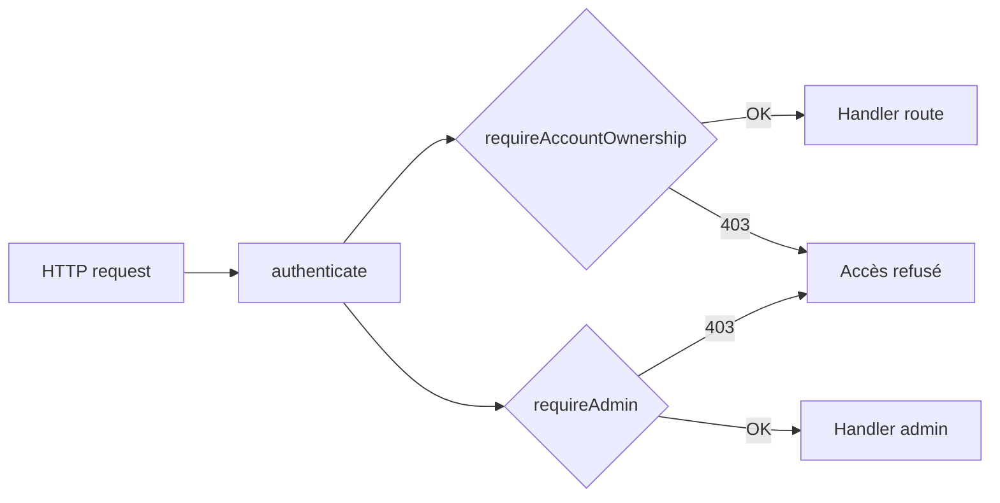

# Security

Overview of the security measures implemented in Nid.

---

## Authentication

### httpOnly JWT

The JWT (HS256) is stored in the **httpOnly cookie** `token`, inaccessible to client-side JavaScript. This protects against XSS attacks that would attempt to steal the token.

- **Single token**: lifetime `JWT_EXPIRY` (24 h by default), same as the cookie
- **Cookie**: `httpOnly`, `sameSite: strict`, `secure` in production
- `POST /api/auth/refresh` re-issues a token for a still-valid session; the frontend does not call it automatically
- The frontend stores no token (neither in `localStorage` nor in URLs: SSE streams use the cookie too)

### Redis JWT Blacklist

On logout, the token is added to a Redis blacklist. The `authenticate` middleware checks this blacklist on every request, enabling **immediate invalidation** of a compromised token. It also rejects (401) a disabled user (`users.is_active = false`).

### Password Hashing

Passwords are hashed with **bcrypt** (12 rounds). A dummy hash is computed even when the user doesn't exist, which prevents account enumeration through timing attacks.

### Rate Limiting

| Route | Limit |
|---|---|
| `POST /api/auth/register` | 3 requests / minute |
| `POST /api/auth/login` | 5 requests / minute |
| General routes | 100 requests / minute / IP |

### 2FA TOTP

Two-factor authentication is optional for local accounts. It uses **TOTP** (RFC 6238) via `otplib`, with QR code generation for setup.

### Passkeys (WebAuthn)

Passwordless sign-in through `@simplewebauthn/server`, bound to the frontend's site (`FRONTEND_URL`). User verification (the device's PIN or biometrics) is required, so the passkey is two factors on its own: the TOTP 2FA is not asked again. Only the public key is stored; challenges are single-use (Redis, 5 min). See [API › Passkeys](api/auth.md#passkeys-webauthn).

### Multi-Provider SSO

Social Login uses the **Arctic** library with server-side OAuth2 code exchange. Social tokens never transit through the frontend.

Supported providers: Google, Microsoft, Discord, Facebook, LinkedIn, Keycloak (providers without configured credentials are disabled). The `state` and the PKCE code verifier are kept 5 min in Redis. Only a provider-verified email may be linked to an existing account or match `ADMIN_EMAIL`.

### Gmail Tokens

Gmail OAuth2 tokens (`access_token`, `refresh_token`) are stored **in plain text** in `mail_accounts`: protection relies on database access. When an account is disconnected, they are set to `NULL`.

---

## Authorization

### Multi-User Isolation

Two Fastify decorators ensure data isolation:

- **`requireAccountOwnership`** — Verifies that the `:accountId` parameter belongs to the authenticated user. Applied on all Gmail, archive, dashboard, and rules routes.
- **`requireAdmin`** — Verifies that `role === 'admin'` in the JWT. Applied on admin and integrity routes, and on the archive trash configuration.

Routes combine them through `authPresets(app)` (`auth`, `accountAuth`, `adminAuth`). Routes without `:accountId` (jobs, notifications, retention policies…) filter on `user_id = request.user.sub`.



### Roles

| Role | Access |
|---|---|
| `user` | Own data (emails, archives, rules, jobs, notifications) |
| `admin` | Same + administration page (users, global jobs, quotas, integrity) |

---

## Input Validation

All user inputs are validated with **Zod**:

- Strict schemas on request bodies, query params, and URL parameters
- TypeScript types inferred from Zod schemas
- Unknown fields are ignored (Zod's default behavior); a validation error returns `400 { error, details }`

Full-text search uses `plainto_tsquery` (not `to_tsquery`), which neutralizes query operators and protects against PostgreSQL operator injection.

---

## Archive Encryption

EML archives can be encrypted at rest on the NAS:

| Parameter | Value |
|---|---|
| Algorithm | AES-256-GCM (confidentiality + integrity) |
| Key derivation | PBKDF2 (SHA-512, 100,000 iterations) |
| Salt | 32 random bytes per file |
| IV | 12 random bytes per file |
| Passphrase storage | Scrypt hash in database — never the passphrase itself |

### Binary Format

```
GMENC01 (7 B) | SALT (32 B) | IV (12 B) | AUTH_TAG (16 B) | CIPHERTEXT
```

- Magic bytes `GMENC01` for encrypted file detection
- On-the-fly decryption without temporary files
- Idempotency: already encrypted files are skipped

---

## Network Security

### Production

- The `nid` container only exposes port 3000 (Nginx), configurable through `APP_PORT`
- CORS configured for `FRONTEND_URL` only

::: warning PostgreSQL and Redis exposed by default
The provided `docker-compose.yml` publishes `5432` (PostgreSQL) and `6379` (Redis) on the host, for dev tools. Remove these `ports:` blocks in production if these services must not be reachable outside the `nid-net` Docker network.
:::

### Webhooks

Webhooks of type `generic` include an `X-Webhook-Signature` header (`sha256=<HMAC-SHA256 of the payload>`), allowing the recipient to verify the request's authenticity. Optional Basic authentication is available (`auth_user`, `auth_password`).

SSRF protection: URLs resolving to a loopback, private, link-local (cloud metadata), CGNAT or unspecified address are refused, unless `WEBHOOK_ALLOW_PRIVATE_NETWORKS=true` (ntfy, Home Assistant on the LAN…).

### Email Content

Remote images in emails are blocked by default in the reader (`notification_preferences.remote_images = 'block'`), which defeats tracking pixels.

---

## File Security

- Filenames in `Content-Disposition` headers are sanitized
- File paths are validated to prevent directory traversal
- EML files are identified by UUID, not by user-provided paths
- Archive share links (`/shared/:token`) use a unique random token, with an expiry date and an optional maximum access count; expired links are cleaned up hourly

## Secrets in Jobs

Credentials passed to a job (encryption passphrase, IMAP password) are stripped from the payload copy stored in the `jobs` table (readable through `/api/jobs` and admin). In Redis, such jobs are removed as soon as they end; they cannot be replayed through `POST /api/jobs/:jobId/retry`.

---

## Audit

All sensitive actions are tracked in the audit log:

| Category | Tracked Actions |
|---|---|
| Authentication | Login (password, Google SSO, social), registration, 2FA enable / disable |
| Gmail accounts | Account connection, disconnection |
| Rules | Creation (including from a template), modification, deletion, execution |
| Bulk operations | Trash, deletion, archiving, labels; deleting a sender's mails |
| Archives | Archive run, ZIP export |
| Administration | User modification, archive trash emptying |

Each entry includes the request's IP address for traceability.

---

## Docker Container Security

### Base Images

- **Alpine images** — Systematic use of Alpine variants to reduce the attack surface (fewer binaries, fewer potential CVEs)
- **Updates** — `apk upgrade --no-cache` in production to apply security patches

### Multi-Stage Build

The root `Dockerfile` (unified nginx + Node image) uses a **multi-stage build** (frontend-builder, backend-builder → deps → runner) so the final image contains:

- No source code
- No devDependencies
- No build tools (npm, corepack, yarn)

### Non-Root User

Processes run as a **non-root user** (`appuser:appgroup`, UID/GID 1001): `entrypoint.sh` starts as root to fix volume permissions, then switches through `su-exec`. Code and nginx config are owned by root (read-only for `appuser`); only `/archives` is writable. This limits the impact of a potential compromise of the Node.js process.

### `.dockerignore`

`.dockerignore` files prevent copying sensitive files into the build context:

- `.env`, `.env.*`, `*.pem`, `*.key` — Environment variables and secrets
- `.git` — Git history
- `node_modules`, `coverage`, `dist` — Build artifacts
- `volumes/` — User data

### Internal Network

Services talk over the `nid-net` Docker network. Containers run with `no-new-privileges` and `cap_drop: ALL` (only the required capabilities are added back). See the warning above about the PostgreSQL and Redis ports published by default.

### `--ignore-scripts`

Production `npm ci` commands use `--ignore-scripts` to prevent execution of potentially malicious `postinstall` scripts in dependencies.
