# Base de données

PostgreSQL 16, requêtes typées avec Kysely. Les types des tables sont dans `backend/src/db/types.ts`.

## Migrations

Migrations in-code dans `backend/src/db/migrations/`, enregistrées dans `backend/src/db/index.ts` et appliquées au démarrage par le `Migrator` Kysely :

| Migration | Contenu |
|---|---|
| `001_full_schema` | Schéma initial (toutes les tables de base, index, trigger `search_vector`) |
| `002_webhook_auth` | `webhooks.auth_user`, `webhooks.auth_password` |
| `003_archive_trash` | `archived_mails.deleted_at` (corbeille), table `system_config` + valeurs par défaut |
| `004_gmail_labels` | Table `gmail_labels` (miroir des libellés Gmail par compte) |
| `005_newsletter_scans` | Table `newsletter_scans` (résultat du job `scan_unsubscribe`) |
| `006_rule_templates` | `rules.template_id` + index unique `(gmail_account_id, template_id)` |
| `007_archive_body_text` | `archived_mails.body_text`, ajouté au `search_vector` (poids D) |
| `008_account_backup_prefs` | `gmail_accounts.backup_enabled`, `backup_interval`, `last_backup_at`, `auth_error_at` ; tokens nullables ; `notification_preferences.remote_images` |
| `009_drop_pii_tracking` | Suppression des tables `pii_findings` et `tracking_pixels` |
| `010_password_changed_at` | `users.password_changed_at` : les JWT émis avant sont refusés (changement / reset du mot de passe) |
| `011_passkeys` | Table `passkeys` (WebAuthn) : `credential_id` unique, clé publique, compteur, transports, nom ; supprimée avec l'utilisateur |

---

## Schéma ERD

```mermaid
erDiagram
    users {
        uuid id PK
        varchar email "unique"
        varchar password_hash "nullable (SSO)"
        varchar role "user | admin"
        varchar display_name
        text avatar_url
        varchar google_id "nullable, unique"
        boolean is_active "default true"
        integer max_gmail_accounts "default 3"
        bigint storage_quota_bytes "default 5 Go"
        varchar totp_secret "nullable"
        boolean totp_enabled "default false"
        varchar encryption_key_hash "nullable"
        timestamptz last_login_at
        timestamptz password_changed_at
        timestamptz created_at
        timestamptz updated_at
    }

    user_social_accounts {
        uuid id PK
        uuid user_id FK
        varchar provider "google | microsoft | discord | ..."
        varchar provider_id
        varchar email
        varchar display_name
        text avatar_url
        timestamptz created_at
    }

    gmail_accounts {
        uuid id PK
        uuid user_id FK
        varchar email
        text access_token "nullable (déconnecté)"
        text refresh_token "nullable (déconnecté)"
        timestamptz token_expiry
        boolean is_active "false = déconnecté"
        boolean backup_enabled "default false"
        text backup_interval "1h | 6h | 24h, default 24h"
        timestamptz last_backup_at
        timestamptz auth_error_at "reconnexion requise"
        timestamptz created_at
        timestamptz updated_at
    }

    archived_mails {
        uuid id PK
        uuid gmail_account_id FK
        varchar gmail_message_id
        varchar thread_id
        text in_reply_to
        text references_header
        text subject
        varchar sender
        text recipient
        timestamptz date
        bigint size_bytes
        boolean has_attachments
        text[] label_ids
        text eml_path
        text snippet
        text attachment_names
        text body_text "NULL si chiffré"
        boolean is_encrypted "default false"
        tsvector search_vector "trigger"
        timestamptz archived_at
        timestamptz deleted_at "nullable, corbeille"
    }

    archived_attachments {
        uuid id PK
        uuid archived_mail_id FK
        varchar filename
        varchar mime_type
        bigint size_bytes
        text file_path
        varchar content_hash "déduplication"
        timestamptz created_at
    }

    archive_shares {
        uuid id PK
        uuid archived_mail_id FK
        uuid user_id FK
        varchar token "unique"
        timestamptz expires_at
        integer access_count
        integer max_access "nullable"
        timestamptz created_at
    }

    rules {
        uuid id PK
        uuid gmail_account_id FK
        varchar name
        text description
        jsonb conditions
        jsonb action
        varchar schedule "hourly | daily | weekly | monthly"
        boolean is_active
        timestamptz last_run_at
        text template_id "nullable"
        timestamptz created_at
        timestamptz updated_at
    }

    jobs {
        uuid id PK
        varchar bullmq_id
        varchar type
        varchar status "scheduled | pending | active | completed | failed | cancelled"
        integer progress
        integer total
        integer processed
        uuid gmail_account_id FK "nullable"
        uuid user_id FK "nullable"
        jsonb payload "sans identifiants"
        text error
        timestamptz created_at
        timestamptz completed_at
    }

    gmail_labels {
        uuid gmail_account_id PK,FK
        varchar id PK "Gmail id ou imported:<name>"
        text name
        varchar color_bg "nullable"
        varchar color_text "nullable"
        varchar type "system | user | category | imported"
        integer messages_total "nullable"
        timestamptz deleted_at "nullable, soft-delete"
        timestamptz updated_at
    }

    newsletter_scans {
        uuid gmail_account_id PK,FK
        jsonb senders
        timestamptz scanned_at
    }

    email_expirations {
        uuid id PK
        uuid gmail_account_id FK
        varchar gmail_message_id
        text subject
        text sender
        timestamptz expires_at
        varchar category "manual | otp | delivery | promo"
        boolean is_deleted
        timestamptz deleted_at
        timestamptz created_at
    }

    saved_searches {
        uuid id PK
        uuid user_id FK
        varchar name
        text query
        varchar icon
        varchar color
        integer sort_order
        timestamptz created_at
        timestamptz updated_at
    }

    retention_policies {
        uuid id PK
        uuid user_id FK
        uuid gmail_account_id FK "nullable"
        varchar name
        varchar label "nullable"
        integer max_age_days
        boolean is_active "default true"
        timestamptz last_run_at "nullable"
        integer deleted_count "default 0"
        timestamptz created_at
        timestamptz updated_at
    }

    notifications {
        uuid id PK
        uuid user_id FK
        varchar type
        varchar title
        text body
        jsonb data
        boolean is_read "default false"
        timestamptz created_at
    }

    notification_preferences {
        uuid id PK
        uuid user_id FK "unique"
        boolean weekly_report "default true"
        boolean job_completed "default true"
        boolean job_failed "default true"
        boolean rule_executed "default false"
        boolean quota_warning "default true"
        boolean integrity_alert "default true"
        boolean weekly_report_toast "default false"
        boolean job_completed_toast "default true"
        boolean job_failed_toast "default true"
        boolean rule_executed_toast "default false"
        boolean quota_warning_toast "default false"
        boolean integrity_alert_toast "default false"
        text remote_images "block | allow, default block"
        timestamptz updated_at
    }

    webhooks {
        uuid id PK
        uuid user_id FK
        varchar name "max 100"
        text url
        varchar type "generic | discord | slack | ntfy"
        text[] events
        boolean is_active "default true"
        varchar secret "nullable, HMAC generic"
        varchar auth_user "nullable"
        varchar auth_password "nullable"
        timestamptz last_triggered_at
        integer last_status
        timestamptz created_at
    }

    audit_logs {
        uuid id PK
        uuid user_id FK
        varchar action "ex: user.login, rule.create"
        varchar target_type "nullable"
        varchar target_id "nullable"
        jsonb details "nullable"
        varchar ip_address "nullable"
        timestamptz created_at
    }

    email_activity_heatmap {
        uuid id PK
        uuid gmail_account_id FK
        integer day_of_week "0 = lundi"
        integer hour_of_day
        integer email_count
        timestamptz computed_at
    }

    sender_scores {
        uuid id PK
        uuid gmail_account_id FK
        varchar sender
        integer email_count
        bigint total_size_bytes
        integer unread_count
        boolean has_unsubscribe
        real read_rate
        real clutter_score "0-100"
        timestamptz computed_at
    }

    cleanup_suggestions {
        uuid id PK
        uuid gmail_account_id FK
        varchar type
        varchar title
        text description
        varchar sender
        integer email_count
        bigint total_size_bytes
        text query
        boolean is_dismissed
        timestamptz computed_at
    }

    inbox_zero_snapshots {
        uuid id PK
        uuid gmail_account_id FK
        integer inbox_count
        integer unread_count
        timestamptz recorded_at
    }

    gmail_api_usage {
        uuid id PK
        uuid gmail_account_id FK
        varchar endpoint
        integer quota_units "default 5"
        timestamptz recorded_at
    }

    system_config {
        varchar key PK "max 100"
        jsonb value
        timestamptz updated_at
    }

    users ||--o{ user_social_accounts : "se connecte via"
    users ||--o{ gmail_accounts : "possède"
    gmail_accounts ||--o{ archived_mails : "archive"
    archived_mails ||--o{ archived_attachments : "contient"
    archived_mails ||--o{ archive_shares : "partagé par"
    users ||--o{ archive_shares : "crée"
    gmail_accounts ||--o{ gmail_labels : "libellés synchronisés"
    gmail_accounts ||--o| newsletter_scans : "dernier scan"
    gmail_accounts ||--o{ email_expirations : "expire"
    gmail_accounts ||--o{ rules : "définit"
    gmail_accounts ||--o{ jobs : "génère"
    users ||--o{ jobs : "possède"
    users ||--o{ saved_searches : "enregistre"
    users ||--o{ retention_policies : "configure"
    users ||--o{ notifications : "reçoit"
    users ||--o| notification_preferences : "paramètre"
    users ||--o{ webhooks : "configure"
    users ||--o{ audit_logs : "trace"
    gmail_accounts ||--o{ email_activity_heatmap : "analyse"
    gmail_accounts ||--o{ sender_scores : "analyse"
    gmail_accounts ||--o{ cleanup_suggestions : "analyse"
    gmail_accounts ||--o{ inbox_zero_snapshots : "suit"
    gmail_accounts ||--o{ gmail_api_usage : "suit"
```



::: info Table `storage_configs`
La migration 001 crée aussi `storage_configs` (une configuration de stockage `local | s3` par utilisateur). Elle n'est ni typée dans `types.ts` ni lue par le code actuel.
:::

---

## Index

| Table | Index | Type | Usage |
|---|---|---|---|
| `users` | `email` | Unique | Login |
| `users` | `google_id` (partiel, non NULL) | Unique | Lookup SSO Google |
| `user_social_accounts` | `(provider, provider_id)` | Unique | Lookup SSO |
| `user_social_accounts` | `user_id` | BTree | Comptes liés d'un utilisateur |
| `archived_mails` | `search_vector` | GIN | Recherche full-text |
| `archived_mails` | `gmail_account_id` | BTree | Filtrage par compte |
| `archived_mails` | `sender` | BTree | Filtrage par expéditeur |
| `archived_mails` | `date DESC` | BTree | Tri par date |
| `archived_mails` | `size_bytes DESC` | BTree | Tri par taille |
| `archived_mails` | `(gmail_account_id, thread_id)` (partiel) | BTree | Fils de discussion |
| `archived_mails` | `(gmail_account_id, deleted_at)` (partiel, `deleted_at IS NOT NULL`) | BTree | Listing corbeille |
| `archived_attachments` | `archived_mail_id` | BTree | Join mails ↔ PJ |
| `archived_attachments` | `content_hash` | BTree | Déduplication |
| `archive_shares` | `token` | Unique | Accès au lien partagé |
| `archive_shares` | `archived_mail_id`, `expires_at` | BTree | Partages d'un mail, nettoyage |
| `rules` | `(gmail_account_id, template_id)` (partiel) | Unique | Création idempotente depuis un template |
| `jobs` | `gmail_account_id` | BTree | Filtrage jobs par compte |
| `jobs` | `status` | BTree | Filtrage par statut |
| `jobs` | `created_at DESC` | BTree | Tri par date |
| `jobs` | `user_id` | BTree | Filtrage jobs par utilisateur |
| `gmail_labels` | `(gmail_account_id, id)` | PK | Libellés d'un compte |
| `newsletter_scans` | `gmail_account_id` | PK | Un scan par compte |
| `email_expirations` | `gmail_account_id`, `expires_at` | BTree | Traitement des expirations |
| `email_expirations` | `(gmail_account_id, gmail_message_id)` (partiel, `is_deleted = false`) | Unique | Une expiration active par mail |
| `saved_searches` | `user_id` | BTree | Filtrage par utilisateur |
| `retention_policies` | `user_id` | BTree | Filtrage par utilisateur |
| `notifications` | `(user_id, created_at)` | BTree | Notifications par utilisateur |
| `notification_preferences` | `user_id` | Unique | Une ligne par utilisateur |
| `audit_logs` | `(user_id, created_at)` | BTree | Logs par utilisateur |
| `audit_logs` | `(action, created_at)` | BTree | Filtrage par action |
| `webhooks` | `user_id` | BTree | Filtrage par utilisateur |
| `email_activity_heatmap` | `(gmail_account_id, day_of_week, hour_of_day)` | Unique | Une case par créneau |
| `sender_scores` | `(gmail_account_id, sender)` | Unique | Un score par expéditeur |
| `inbox_zero_snapshots` | `(gmail_account_id, recorded_at DESC)` | BTree | Historique |
| `gmail_api_usage` | `(gmail_account_id, recorded_at)` | BTree | Stats quota par compte |
| `gmail_api_usage` | `recorded_at` | BTree | Nettoyage données anciennes |

---

## Recherche full-text

Le champ `search_vector` est mis à jour par le trigger `mail_search_vector_update` (fonction `update_mail_search_vector()`) à chaque insert/update sur `archived_mails` :

```sql
-- Poids de recherche :
-- A (le plus fort) : sujet
-- B : expéditeur, noms des pièces jointes
-- C : snippet
-- D : corps du mail (body_text, migration 007)
NEW.search_vector :=
  setweight(to_tsvector('nid_french', COALESCE(NEW.subject,          '')), 'A') ||
  setweight(to_tsvector('nid_french', COALESCE(NEW.sender,           '')), 'B') ||
  setweight(to_tsvector('nid_french', COALESCE(NEW.snippet,          '')), 'C') ||
  setweight(to_tsvector('nid_french', COALESCE(NEW.attachment_names, '')), 'B') ||
  setweight(to_tsvector('nid_french', COALESCE(NEW.body_text,        '')), 'D');
```

`body_text` reste `NULL` pour les archives chiffrées. Les archives antérieures à la migration 007 sont complétées par le job `backfill_body_text`.

La configuration `nid_french` (migration 012) est une copie de `french` avec `unaccent` avant la racinisation : `electricite` trouve `Électricité`, `factures` trouve `facture`.

Les requêtes utilisent `websearch_to_tsquery` — syntaxe à la Google (`"phrase exacte"`, `-exclu`, `OR`), sans erreur de syntaxe possible quelle que soit la saisie (helper `ftsQuery()` dans `utils/db.ts`) :

```sql
SELECT *, ts_rank(search_vector, query) AS rank
FROM archived_mails, websearch_to_tsquery('nid_french', 'facture 2024') query
WHERE gmail_account_id = $1
  AND deleted_at IS NULL
  AND search_vector @@ query
ORDER BY rank DESC, date DESC;
```

Les filtres `ILIKE '%…%'` (`sender`, `subject`, `filename` des pièces jointes) s'appuient sur des index GIN `pg_trgm` (migration 012).

---

## JSONB — Format des règles

### `conditions` (tableau, au moins une)

```json
[
  { "field": "from", "operator": "contains", "value": "newsletter@" },
  { "field": "subject", "operator": "contains", "value": "promotion" }
]
```

Champs : `from`, `to`, `subject`, `has_attachment`, `size_gt`, `size_lt`, `label`, `older_than`, `newer_than`

Opérateurs : `contains`, `not_contains`, `equals`, `not_equals`, `gt`, `lt`, `is_true`

Les conditions sont converties en requête Gmail (`buildGmailQuery`) ; une combinaison champ/opérateur non traduisible est refusée à la validation.

### `action` (objet)

```json
{ "type": "trash" }
{ "type": "label", "labelId": "Label_123" }
{ "type": "archive" }
{ "type": "archive_nas" }
```

Types : `trash`, `delete`, `label`, `unlabel`, `archive`, `archive_nas`, `mark_read`, `mark_unread`. `archive_nas` enfile un job `archive_mails` ; les autres un `bulk_operation`.
