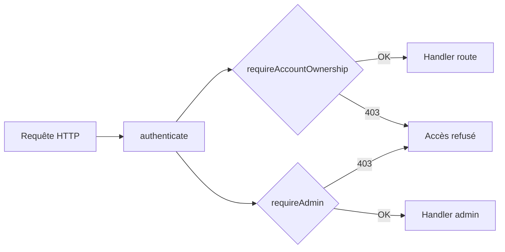

# Sécurité

Vue d'ensemble des mesures de sécurité implémentées dans Nid.

---

## Authentification

### JWT httpOnly

Le JWT (HS256) est stocké dans le **cookie httpOnly** `token`, inaccessible au JavaScript côté client. Cela protège contre les attaques XSS qui tenteraient de voler le token.

- **Un seul token** : durée de vie `JWT_EXPIRY` (24 h par défaut), identique à celle du cookie
- **Cookie** : `httpOnly`, `sameSite: strict`, `secure` en production
- `POST /api/auth/refresh` ré-émet un token pour une session encore valide ; le frontend ne le fait pas automatiquement
- Le frontend ne stocke aucun token (ni `localStorage`, ni URL : les flux SSE utilisent aussi le cookie)

### Blacklist JWT Redis

Au logout, le token est ajouté à une blacklist Redis. Le middleware `authenticate` vérifie cette blacklist à chaque requête, permettant l'**invalidation immédiate** d'un token compromis. Il refuse aussi (401) un utilisateur désactivé (`users.is_active = false`).

### Hashage des mots de passe

Les mots de passe sont hashés avec **bcrypt** (12 rounds). Un hash factice est calculé même quand l'utilisateur n'existe pas, ce qui empêche l'énumération de comptes par timing attack.

### Rate limiting

| Route | Limite |
|---|---|
| `POST /api/auth/register` | 3 requêtes / minute |
| `POST /api/auth/login` | 5 requêtes / minute |
| Routes générales | 100 requêtes / minute / IP |

### 2FA TOTP

L'authentification à deux facteurs est optionnelle pour les comptes locaux. Elle utilise **TOTP** (RFC 6238) via `otplib`, avec génération de QR code pour la configuration.

### Passkeys (WebAuthn)

Connexion sans mot de passe via `@simplewebauthn/server`, liée au site du frontend (`FRONTEND_URL`). La vérification utilisateur (code ou biométrie de l'appareil) est obligatoire, donc la passkey vaut à elle seule deux facteurs : la 2FA TOTP n'est pas redemandée. Seule la clé publique est stockée ; les challenges sont à usage unique (Redis, 5 min). Voir [API › Passkeys](api/auth.md#passkeys-webauthn).

### SSO multi-providers

Le Social Login utilise la librairie **Arctic** avec échange de code OAuth2 côté serveur. Les tokens sociaux ne transitent jamais par le frontend.

Providers supportés : Google, Microsoft, Discord, Facebook, LinkedIn, Keycloak (les providers sans identifiants configurés sont désactivés). Le `state` et le code verifier PKCE sont conservés 5 min dans Redis. Seul un email vérifié par le provider peut être rattaché à un compte existant ou correspondre à `ADMIN_EMAIL`.

### Tokens Gmail

Les tokens OAuth2 Gmail (`access_token`, `refresh_token`) sont stockés **en clair** dans `mail_accounts` : la protection repose sur l'accès à la base. À la déconnexion d'un compte, ils sont mis à `NULL`.

---

## Autorisation

### Isolation multi-utilisateurs

Deux décorateurs Fastify assurent l'isolation des données :

- **`requireAccountOwnership`** — Vérifie que le paramètre `:accountId` appartient à l'utilisateur authentifié. Appliqué sur toutes les routes Gmail, archive, dashboard et règles.
- **`requireAdmin`** — Vérifie que `role === 'admin'` dans le JWT. Appliqué sur les routes admin, intégrité et la configuration de la corbeille archives.

Les routes les combinent via `authPresets(app)` (`auth`, `accountAuth`, `adminAuth`). Les routes sans `:accountId` (jobs, notifications, règles de rétention…) filtrent sur `user_id = request.user.sub`.



### Rôles

| Rôle | Accès |
|---|---|
| `user` | Ses propres données (mails, archives, règles, jobs, notifications) |
| `admin` | Idem + page administration (utilisateurs, jobs globaux, quotas, intégrité) |

---

## Validation des entrées

Toutes les entrées utilisateur sont validées avec **Zod** :

- Schémas stricts sur les corps de requête, query params et paramètres d'URL
- Types TypeScript inférés depuis les schémas Zod
- Les champs inconnus sont ignorés (comportement par défaut de Zod) ; une erreur de validation renvoie `400 { error, details }`

La recherche full-text utilise `plainto_tsquery` (et non `to_tsquery`), ce qui neutralise les opérateurs de requête et protège contre l'injection d'opérateurs PostgreSQL.

---

## Chiffrement des archives

Les archives EML peuvent être chiffrées au repos sur le NAS :

| Paramètre | Valeur |
|---|---|
| Algorithme | AES-256-GCM (confidentialité + intégrité) |
| Dérivation de clé | PBKDF2 (SHA-512, 100 000 itérations) |
| Salt | 32 octets aléatoires par fichier |
| IV | 12 octets aléatoires par fichier |
| Stockage passphrase | Hash scrypt en base — jamais la passphrase elle-même |

### Format binaire

```
GMENC01 (7 B) | SALT (32 B) | IV (12 B) | AUTH_TAG (16 B) | CIPHERTEXT
```

- Magic bytes `GMENC01` pour la détection des fichiers chiffrés
- Déchiffrement à la volée sans fichier temporaire
- Idempotence : les fichiers déjà chiffrés sont ignorés

---

## Sécurité réseau

### Production

- Le conteneur `nid` n'expose que le port 3000 (Nginx), configurable via `APP_PORT`
- CORS configuré sur `FRONTEND_URL` uniquement

::: warning PostgreSQL et Redis exposés par défaut
Le `docker-compose.yml` fourni publie `5432` (PostgreSQL) et `6379` (Redis) sur l'hôte, pour les outils de dev. Supprimez ces blocs `ports:` en production si ces services ne doivent pas être joignables hors du réseau Docker `nid-net`.
:::

### Webhooks

Les webhooks de type `generic` incluent un header `X-Webhook-Signature` (`sha256=<HMAC-SHA256 du payload>`), permettant au destinataire de vérifier l'authenticité de la requête. Une authentification Basic optionnelle est possible (`auth_user`, `auth_password`).

Protection SSRF : les URL qui résolvent vers une adresse loopback, privée, link-local (métadonnées cloud), CGNAT ou non spécifiée sont refusées, sauf si `WEBHOOK_ALLOW_PRIVATE_NETWORKS=true` (ntfy, Home Assistant sur le LAN…).

### Contenu des mails

Les images distantes des mails sont bloquées par défaut dans le lecteur (`notification_preferences.remote_images = 'block'`), ce qui évite les pixels de suivi.

---

## Sécurité des fichiers

- Les noms de fichiers dans les headers `Content-Disposition` sont sanitisés
- Les chemins de fichiers sont validés pour empêcher les traversées de répertoire
- Les fichiers EML sont identifiés par UUID, pas par des chemins utilisateur
- Les liens de partage d'archive (`/shared/:token`) utilisent un token aléatoire unique, avec date d'expiration et nombre d'accès maximal optionnel ; les liens expirés sont nettoyés toutes les heures

## Secrets dans les jobs

Les identifiants passés à un job (phrase secrète de chiffrement, mot de passe IMAP) sont retirés de la copie du payload stockée dans la table `jobs` (lisible via `/api/jobs` et l'admin). Dans Redis, ces jobs sont supprimés dès leur fin ; ils ne peuvent pas être relancés via `POST /api/jobs/:jobId/retry`.

---

## Audit

Toutes les actions sensibles sont tracées dans le journal d'audit :

| Catégorie | Actions tracées |
|---|---|
| Authentification | Connexion (mot de passe, SSO Google, social), inscription, activation / désactivation de la 2FA |
| Comptes Gmail | Connexion, déconnexion d'un compte |
| Règles | Création (dont depuis un template), modification, suppression, exécution |
| Opérations bulk | Corbeille, suppression, archivage, libellés ; suppression des mails d'un expéditeur |
| Archives | Lancement d'un archivage, export ZIP |
| Administration | Modification d'utilisateur, vidage de la corbeille archives |

Chaque entrée inclut l'adresse IP de la requête pour la traçabilité.

---

## Sécurité des conteneurs Docker

### Images de base

- **Images Alpine** — Utilisation systématique de variantes Alpine pour réduire la surface d'attaque (moins de binaires, moins de CVE potentielles)
- **Mises à jour** — `apk upgrade --no-cache` en production pour appliquer les correctifs de sécurité

### Build multi-stage

Le `Dockerfile` racine (image unifiée nginx + Node) utilise un **build multi-stage** (frontend-builder, backend-builder → deps → runner) pour que l'image finale ne contienne :

- Ni le code source
- Ni les devDependencies
- Ni les outils de build (npm, corepack, yarn)

### Utilisateur non-root

Les processus tournent avec un **utilisateur non-root** (`appuser:appgroup`, UID/GID 1001) : `entrypoint.sh` démarre en root pour corriger les permissions des volumes, puis bascule via `su-exec`. Le code et la config nginx appartiennent à root (lecture seule pour `appuser`) ; seul `/archives` est accessible en écriture. Cela limite l'impact d'une éventuelle compromission du processus Node.js.

### `.dockerignore`

Des fichiers `.dockerignore` empêchent la copie de fichiers sensibles dans le contexte de build :

- `.env`, `.env.*`, `*.pem`, `*.key` — Variables d'environnement et secrets
- `.git` — Historique Git
- `node_modules`, `coverage`, `dist` — Artefacts de build
- `volumes/` — Données utilisateur

### Réseau interne

Les services communiquent via le réseau Docker `nid-net`. Les conteneurs tournent avec `no-new-privileges` et `cap_drop: ALL` (seules les capacités nécessaires sont rajoutées). Voir l'avertissement ci-dessus sur les ports PostgreSQL et Redis publiés par défaut.

### `--ignore-scripts`

Les commandes `npm ci` de production utilisent `--ignore-scripts` pour empêcher l'exécution de scripts `postinstall` potentiellement malveillants dans les dépendances.
